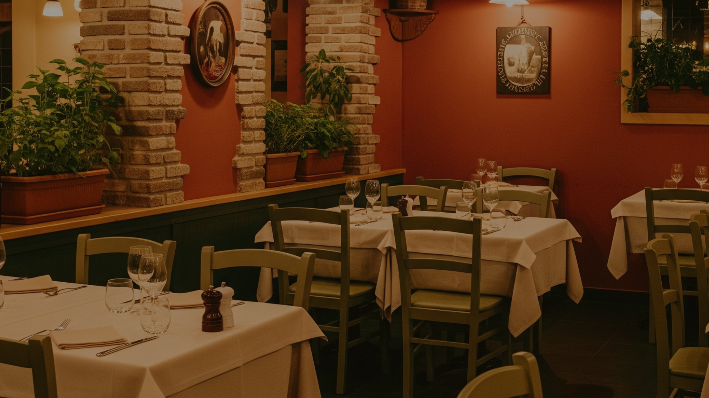

# 🍝 La Bella Trattoria - Cardápio Digital

Bem-vindo ao repositório do site **La Bella Trattoria**, um cardápio digital responsivo desenvolvido com HTML5, CSS3 e JavaScript puro. A página destaca os pratos, facilita a busca por nome ou ingrediente e apresenta preços e informações para clientes com restrições alimentares.

  
*(Imagem ilustrativa do banner principal)*

## LINK VERCEL: [La Bella Trattoria](https://projetocardapio-phi.vercel.app/)

Cardápio: https://projetocardapio-phi.vercel.app/cardapio/  
Painel do restaurante: https://projetocardapio-phi.vercel.app/painel-restaurante/


---

## 🍷 Sobre o Projeto

Este é um cardápio online para uma trattoria italiana fictícia. O objetivo é tornar as categorias e os pratos fáceis de consultar em celulares e computadores, preservando a identidade visual italiana do projeto.

O site inclui seções para **Entradas, Massas, Pizzas, Drinks e Sobremesas**, com fotos, descrições e preços. O cabeçalho fixo facilita a navegação entre categorias. As informações do estabelecimento ficam em uma página separada.

---

## ✨ Funcionalidades Principais

- **Layout responsivo** com destaque editorial, navegação por categorias adaptada a telas pequenas e cartões de pratos reorganizados para facilitar a leitura.
- **Busca por nome ou ingrediente**, sem diferenciar acentos, com contagem de resultados, botão para limpar e estado sem resultados.
- **Favoritos persistentes** neste navegador e filtro para exibir apenas os pratos salvos.
- **Ordenação de pratos por preço**, crescente ou decrescente, dentro de cada categoria.
- **Filtro “Sem carne na descrição”** combinado com busca e favoritos; busca também os ingredientes cadastrados de cada prato. A classificação não certifica o preparo nem exclui contaminação cruzada.
- **Personalização de pratos** com ingredientes para retirar, extras sugeridos, quantidade e observações por item.
- **Carrinho editável** com alteração de quantidade, personalização de cada linha, tamanhos de pizza, remoção de itens e subtotal persistente.
- **Seletor de idioma** para português, inglês, francês, italiano, espanhol, mandarim, japonês e alemão; nomes e descrições de pratos são traduzidos quando há texto disponível.
- **Detalhes demonstrativos dos pratos** sobre porção, picância, ingredientes e opção sem álcool. Esses dados são exemplos não verificados, nunca uma fonte para decisões sobre alergias.
- **Divisão ilustrativa da conta** por partes iguais ou por atribuição de quantidades de cada item às pessoas, com distribuição correta de centavos. Não processa nem solicita pagamentos.
- **Finalização preparada para WhatsApp** com consumo no local, retirada ou entrega, nome, endereço, opção de pagamento e estimativas ilustrativas.
- **Recomendações individuais** de pratos, sem combos ou descontos inventados, e compartilhamento do cardápio ou de um prato específico.
- **QR Code compartilhável**, gerado sob demanda quando a seção fica visível, e metadados de compartilhamento e SEO.
- **Painel separado do restaurante** para consultar pedidos, editar endereço, horários, pagamentos, entrega, retirada e capacidade demonstrativa das reservas.
- **Reservas por disponibilidade local**, com limite de pessoas por data e horário, consulta pelo código de seis caracteres e cancelamento no painel.
- **Códigos curtos para pedidos**, fáceis de ler e informar ao consultar o acompanhamento.
- **Painel de pedidos**, com consulta dos itens registrados, filtros e atualização de etapa para recebido, enviado, em produção e concluído.
- **Carregamento adiado das fotos dos pratos** e prioridade de carregamento para a imagem principal.
- **Protótipo local dos recursos operacionais**, com rastreio e mudança de status de pedidos fictícios, reservas e fila de espera locais, edição do menu, alergênicos não verificados, oferta demonstrativa e moderação de comentários.
- **Controles de acessibilidade**, com texto ampliado, contraste reforçado e foco de teclado, com preferências locais.
- **Fotos, ingredientes descritos e preços** organizados por categoria.
- **Aviso sobre alergênicos e contaminação cruzada**, orientando o cliente a confirmar detalhes com a equipe.
- **Navegação fluida entre áreas e categorias**: cardápio, painel e página inicial usam transições suaves ao trocar de página; os links de categoria rolam até a seção, destacam a categoria atual e acompanham essa categoria na barra horizontal em telas pequenas. As transições respeitam a preferência por movimento reduzido e, quando não são suportadas pelo navegador, os links continuam funcionando normalmente.
- **Paleta clara em verde e vermelho**, estados de foco visíveis e suporte à preferência por movimento reduzido.
- **Atalho para pular ao cardápio**, foco visível e respeito à preferência por movimento reduzido.
- **HTML, CSS e JavaScript separados**, sem dependências de bibliotecas.

---

## 🛠️ Tecnologias Utilizadas

| Tecnologia | Uso |
|------------|-----|
| HTML5 | Estrutura semântica do conteúdo |
| CSS3 | Estilização, variáveis, grid, animações, responsividade |
| JavaScript (Vanilla) | Busca, favoritos, ordenação, personalização e pedidos |
| Google Fonts | Tipografia *Playfair Display* e *Poppins* |

## 🛒 Pedidos e personalização

O carrinho guarda o rascunho no navegador. Cada item pode ter quantidade, ingredientes retirados, acréscimos sugeridos e observações próprias. O checkout monta uma mensagem para o WhatsApp, mas o pedido só é confirmado depois que o cliente a revisa e envia. O site não processa pagamentos nem envia pedidos a um servidor.

Para ativar o envio, preencha `data-whatsapp-number` na tag `<html>` do `index.html` com o número oficial em formato internacional, apenas com dígitos. Exemplo de formato: `5511999999999`. Sem o número, o botão de envio permanece desativado.

As opções de retirada usam os ingredientes mencionados nas descrições atuais do cardápio. Os acréscimos são sugestões construídas a partir de ingredientes que já aparecem no menu; como não há preços ou confirmação de estoque, o subtotal não os inclui e a equipe deve confirmar valores e disponibilidade pelo WhatsApp. As descrições são resumidas e não substituem uma ficha técnica: clientes com alergias devem confirmar os ingredientes e o risco de contaminação cruzada com o restaurante.

## ⚠️ Dados de demonstração

O endereço, horário, meios de pagamento, prazo e taxa de entrega, cobertura e tamanhos/preços de pizza exibidos no site são hipotéticos. O painel do restaurante identifica esses dados como demonstração. Revise-os e substitua-os pelos dados reais antes de publicar ou aceitar pedidos. Os preços do cardápio também devem ser conferidos.

Edite `restaurant-config.js` para ajustar os tamanhos e multiplicadores de pizza, as estimativas de entrega/retirada e as sugestões de pratos. As informações fictícias do estabelecimento e os limites de reserva são editáveis na página `painel-restaurante/`. Se o domínio mudar, atualize também as URLs canonical/Open Graph em `cardapio/index.html`, o `robots.txt` e o `sitemap.xml` da raiz. Não preencha o WhatsApp com um número inventado; o envio permanece desativado até configurar o contato oficial.

O QR Code é solicitado ao serviço QuickChart apenas quando sua seção entra na tela e codifica o endereço público configurado. Isso faz uma requisição externa ao serviço; substitua ou hospede o gerador de QR localmente se não quiser depender de terceiros.

## 🧪 Protótipo de recursos locais

A seção “Pedidos e recursos em demonstração” permite registrar os pratos e personalizações atualmente no carrinho, sem guardar nome, contato ou endereço. O painel do restaurante mostra os itens, quantidades, subtotal e código curto; permite filtrar e alterar o estado entre recebido, enviado, em produção e concluído. O cliente pode consultar o pedido pelo código. A demonstração não recebe automaticamente as mensagens enviadas pelo WhatsApp e não representa pedidos reais.

No cardápio, é possível solicitar reservas dentro da capacidade configurada e consultar uma reserva pelo código. O painel do restaurante lista as reservas e permite cancelá-las. A edição de pratos, notas de alergênicos não verificadas, ofertas fictícias, combos, comentários para moderação e controles de acessibilidade fica na área de demonstração do cardápio. A lista de espera continua apenas simulada.

Esses fluxos não têm servidor, login, validação de compra, sincronização entre aparelhos, proteção de dados ou envio ao restaurante. Pedidos, estados, itens e reservas ficam apenas no `localStorage` deste navegador. A disponibilidade é uma simulação local, sem garantia contra reservas simultâneas. Para compartilhar os dados entre o cardápio e o painel, publique as duas pastas no mesmo projeto e domínio Vercel, nos caminhos `/cardapio/` e `/painel-restaurante/`. Deployments ou domínios separados usam armazenamentos diferentes. Qualquer pessoa que use o mesmo perfil do navegador pode ler e alterar esses dados. Não use informações pessoais, avaliações reais ou dados operacionais reais nesses formulários.

Para transformar esses exemplos em funções reais, será necessário adicionar um backend com autenticação e autorização, banco de dados, armazenamento de imagens e regras de moderação. Antes de publicar alergênicos, preços, ofertas, disponibilidade ou avaliações, confirme os dados com o restaurante e as pessoas envolvidas.

Para referência sobre a receita tradicional de carbonara, consulte [BBC Good Food](https://www.bbcgoodfood.com/recipes/ultimate-spaghetti-carbonara-recipe). Os ingredientes apresentados no site continuam limitados ao que consta nas descrições deste cardápio.

---

## 📁 Estrutura de Pastas
projetocardapio-main/
├── index.html # Acesso ao cardápio e ao painel
├── assets/ # Imagens compartilhadas pelas páginas
├── cardapio/ # Cardápio e recursos demonstrativos
│ ├── index.html
│ ├── style.css
│ ├── demo-features.js
│ └── readme.md
└── painel-restaurante/ # Pedidos, informações do restaurante e reservas
    ├── index.html
    ├── style.css
    └── panel.js

text

As imagens ficam na pasta `assets/` da raiz e são compartilhadas pelas páginas.

---

## 🚀 Como Utilizar

1. **Clone o repositório** ou faça o download dos arquivos.
   ```bash
   git clone https://github.com/seu-usuario/la-bella-trattoria.git
Abra `index.html` para escolher entre o cardápio e o painel. Para testar reservas compartilhadas, use um servidor local e acesse as duas páginas pelo mesmo endereço. No Vercel, publique a raiz do projeto, sem definir `cardapio/` como diretório raiz.

O projeto não depende de backend nem de bibliotecas JavaScript. Para testar a comunicação entre cardápio e painel, acesse ambos pelo mesmo servidor local, pois o navegador separa o armazenamento por origem.

Para editar, utilize qualquer editor de código (VS Code, Sublime, etc.).

As imagens devem estar na pasta `assets/` da raiz. Se quiser alterar os pratos ou fundos, substitua os arquivos mantendo os mesmos nomes ou atualize os caminhos no HTML/CSS.

🎨 Personalização
O design é altamente customizável através das variáveis CSS definidas no :root do arquivo style.css:

css
:root {
    --rosso: #8B1E1E;        /* Vermelho principal */
    --oro: #C8984B;          /* Dourado */
    --crema: #FDF6EC;        /* Fundo creme */
    --testo: #2C1810;        /* Cor do texto */
    ...
}
Altere esses valores para mudar totalmente a identidade visual do site. As seções de fundo também podem ser trocadas ajustando as classes .section-entradas, .section-massas, etc.

📝 Licença
Este projeto é de uso livre para fins pessoais, educacionais ou comerciais. Sinta-se à vontade para modificar, compartilhar e adaptar como desejar.

🤝 Contribuições
Contribuições são bem-vindas! Caso encontre algum problema ou tenha sugestões de melhoria, abra uma issue ou envie um pull request.

📸 Créditos das Imagens
As imagens utilizadas são meramente ilustrativas. Para um projeto real, recomenda-se utilizar fotografias próprias ou de bancos de imagem gratuitos (Unsplash, Pexels, etc.). As imagens atuais estão na pasta `assets/` da raiz e devem ser substituídas pelas suas.

## FEITO POR: João Pedro Stadler Roza Santos

## CONTATOS:
 EMAIL:joaopedrostadlerroza.senai@gmail.com
LINKEDIN:https://www.linkedin.com/in/jo%C3%A3o-pedro-stadler-6ab4583b6/

Feito com ❤️ e muita massa fresca.
La Bella Trattoria - Onde tradição e paixão se encontram em cada prato.